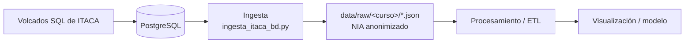

# Proyecto N · [Título del proyecto]

> **Plantilla.** Sustituye todo lo que va entre corchetes y borra las indicaciones en cursiva a medida que completes cada sección. Borra también las secciones de bloques que tu proyecto no trabaje.

## Descripción y objetivo

*Dos o tres líneas: qué problema resuelve el proyecto, con qué datos y qué resultado final se obtiene (dashboard, modelo…).*

[Descripción]

## Arquitectura

*Diagrama del pipeline completo. Empieza con uno provisional en el Bloque 0 y actualízalo al terminar cada bloque.*



## Carga de datos en PostgreSQL

Los datos de origen son los volcados de ITACA en `data/exportaciones/SQL/` (no versionados): un `.sql` por tabla y curso escolar (`<tabla>_<curso>.sql`, del 2021-22 al 2025-26). Cada tabla se carga en **una sola tabla** de PostgreSQL con el nombre base del fichero, uniendo los cinco cursos. La columna `anyo` indica el año de inicio del curso (2021 = 2021-22).

- Contenedor: `bigdata-postgres` (ver `docker-compose.yml`), puerto `4820`, usuario `admin`.
- Base de datos: `postgres`, esquema `public`.
- Todas las columnas son `TEXT` salvo `anyo` (`INTEGER`). Los valores se guardan tal cual vienen en el origen (los campos vacíos son `' '`).

| Tabla | 2021 | 2022 | 2023 | 2024 | 2025 | Total |
|---|---:|---:|---:|---:|---:|---:|
| `alumnos` | 1.341 | 1.411 | 1.445 | 1.465 | 1.531 | 7.193 |
| `calificaciones` | 18.906 | 20.324 | 19.130 | 22.510 | 25.944 | 106.814 |
| `contenidos` | 265 | 278 | 260 | 372 | 513 | 1.688 |
| `cursos` | 70 | 71 | 68 | 94 | 110 | 413 |

Los recuentos coinciden con las filas de cada `.sql` (indicadas en su cabecera).

### Cómo recargar una tabla

Solo el fichero del 2021-22 contiene el `CREATE TABLE`; los demás cursos solo traen `INSERT`. Por eso se borra la tabla y se ejecutan los cinco ficheros en orden dentro de una transacción (si algo falla, no queda una carga a medias). Desde `data/exportaciones/SQL/`:

```bash
T=calificaciones   # alumnos | calificaciones | contenidos | cursos
{ echo "BEGIN;"; echo "DROP TABLE IF EXISTS $T;"
  cat ${T}_2021_22.sql ${T}_2022_23.sql ${T}_2023_24.sql ${T}_2024_25.sql ${T}_2025_26.sql \
    | sed "s/^INSERT INTO  (/INSERT INTO $T (/"
  echo "COMMIT;"; } \
| docker exec -i bigdata-postgres psql -U admin -d postgres -q -v ON_ERROR_STOP=1
```

El `sed` corrige un fallo del origen: en `calificaciones_2022_23.sql` (línea 9024) hay un `INSERT INTO  (...)` sin nombre de tabla.

Comprobación:

```sql
SELECT anyo, COUNT(*) FROM calificaciones GROUP BY anyo ORDER BY anyo;
```

## Ingesta a `data/raw/`

El script [`ingesta/ingesta_itaca_bd.py`](ingesta/ingesta_itaca_bd.py) lee las tablas de PostgreSQL, se queda solo con las columnas que necesita el proyecto, anonimiza el NIA y guarda un JSON por tabla y curso escolar:

```
data/raw/
├── 2021_22/
│   ├── alumnos.json
│   ├── calificaciones.json
│   ├── contenidos.json
│   └── cursos.json
├── 2022_23/
├── 2023_24/
├── 2024_25/
└── 2025_26/
```

| Fichero | Campos | Origen en PostgreSQL |
|---|---|---|
| `alumnos.json` | `anyo`, `nia`, `curso`, `turno`, `grupo` | `alumnos` |
| `contenidos.json` | `anyo`, `curso`, `modulo`, `nombre_modulo` | `contenidos` (`codigo` → `modulo`, `nombre_cas` → `nombre_modulo`) |
| `calificaciones.json` | `anyo`, `nia`, `curso`, `modulo`, `nota`, `evaluacion` | `calificaciones` (`alumno` → `nia`, `contenido` → `modulo`, `nota_numerica` → `nota`) |
| `cursos.json` | `anyo`, `codigo`, `nombre_cas`, `padre` | `cursos` |

Los valores se guardan tal cual vienen de la base de datos (texto, con `' '` en los vacíos); la limpieza se deja para la fase de ETL.

### Anonimización del NIA

El NIA se sustituye por los 10 primeros caracteres de su SHA-256 antes de escribir ningún fichero:

```python
hashlib.sha256(str(nia).encode()).hexdigest()[:10]
```

Cada NIA se calcula una sola vez y se guarda en una caché que se reutiliza en `alumnos` y `calificaciones`, así que el mismo alumno tiene el mismo identificador en ambas tablas y en todos los cursos, y se pueden seguir cruzando.

### Ejecución

Requiere el contenedor de PostgreSQL arrancado y un `.env` en la raíz con `DB_HOST`, `DB_PORT`, `DB_NAME`, `DB_USER` y `DB_PASSWORD`. Desde la raíz del proyecto:

```bash
python -m venv .venv && source .venv/bin/activate
pip install -r requirements.txt
python ingesta/ingesta_itaca_bd.py
```

Cada ejecución sobrescribe los JSON existentes. `data/raw/` no se versiona (está en `.gitignore`).

**Nota sobre los datos:** en 2023-24 hay 9 NIA con calificaciones que no aparecen en `alumnos` de ese curso. Viene así del origen, no de la anonimización.

# bigdata-p2-itaca
